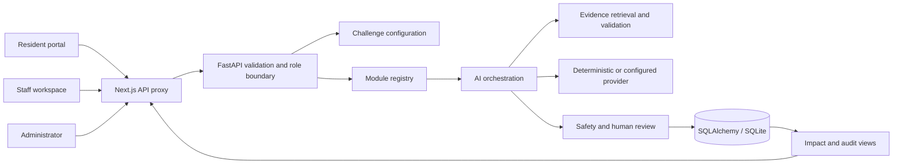

# Architecture

CIVICFORGE AI uses one frontend and one backend with a local database. The reusable core covers cases, sources, review, audit, and measurement. Challenge-specific behavior lives behind module registration and validated configuration.

## Data flow

1. Pydantic validates input length, module, borough, and payload shape. Staff and administrator actions pass through role checks.
2. Configuration determines which modules are available. Disabled modules reject submissions instead of accepting invisible workflows.
3. The chosen module classifies the request and maps it to relevant resource categories. Simple routing uses deterministic rules.
4. Retrieval returns stored passages and provenance from the resource database. It does not fetch arbitrary submitted URLs.
5. The provider produces validated structured output. The optional compatible provider extracts an exact quotation of the resident's need and supplies source IDs for validation. Recommendations, policy statements, priorities, and decisions remain deterministic and source-bound. The default provider is deterministic and its demo output is visibly marked simulated. External-provider failure uses the same fallback.
6. Source and safety checks restrict what becomes a recommendation. Insufficient evidence and consequential matters require staff review; confidence is a heuristic, not a calibrated probability of correctness.
7. The request, result, citations, duplicate indicator, and review flag become a persisted case. Evaluation and audit records support later inspection.
8. A staff member can add a note and resolve a case. This changes workflow status; it does not grant services or decide eligibility.
9. The impact endpoint distinguishes observed prototype activity, test results, operational estimates, and simulated metrics.

## Core contracts

Read [the API contract](api-contract.md) for request and response types. The stable envelope is `Case → Analysis`, including sources, recommendations, workflow steps, processing time, provider identity, and simulation status. Modules can add isolated routes and persistence without breaking this envelope.

`config/challenge_config.yaml` contains the borough, challenge title, problem, target users, desired outcomes, enabled modules, success metrics, constraints, data sources, demo scenario, and human-review requirement. Administrator updates validate and persist the configuration. The frontend uses it for challenge branding, module navigation, context, and demonstration content. Success metric labels are goals; they do not become observed outcomes merely because they appear in configuration.

The database contains resource provenance, enquiries, staff review notes, feedback, evaluation activity, and audit summaries. SQLite is appropriate for a single-machine prototype. SQLAlchemy avoids SQLite-specific query logic where practical. A PostgreSQL URL is an architectural extension point, not evidence that a production migration has been tested.

## AI orchestration boundaries

| Component | Responsibility |
| --- | --- |
| Input processor | Validate and normalise a bounded resident request. |
| Intent classifier | Select a category or routing suggestion within the module. |
| Context retriever | Retrieve relevant stored evidence with metadata. |
| Workflow router | Execute module behavior and expose progress. |
| Recommendation engine | Produce next steps and explain any matching score or skill gaps. |
| Response generator | Return validated structured output through a provider abstraction. |
| Source validator | Keep citations tied to retrieved resources; surface insufficient evidence. |
| Safety layer | Detect sensitive requests, flag uncertainty, and require human review. |
| Evaluation logger | Record processing and assessment activity with honest metric labels. |

This is bounded orchestration. `backend/app/ai/tools.py` implements a typed `ToolRegistry`; orchestration invokes its allowlisted `retrieve_approved_resources` operation and audits completion. It validates the known borough/modules and limits retrieved passages. There is no open-ended autonomous agent permitted to send messages, execute arbitrary tools, fetch arbitrary URLs, or approve an entitlement.

## Extending a challenge

The built-in modules share the core case envelope but retain their own classification and recommendation behavior. `custom` is a working example workflow rather than an empty page. Add a new problem in an isolated module, register its descriptor and optional API router, and use a keyed frontend component registry for specialized input or result presentation. Model classes must be imported before migration metadata is evaluated; new schema changes require a migration.

`CivicModule.evaluate(message, analysis)` returns typed runtime criteria, which case creation persists on an evaluation row. `CivicModule.impact_metrics(cases, evaluations)` returns typed, evidence-labelled aggregates. Shared services invoke both hooks generically. The custom example checks mandatory human review and source-grounded recommendations; those runtime invariants are distinct from an accuracy benchmark.

The exact extension points and examples are in [challenge-adaptation.md](challenge-adaptation.md). Register evaluators and impact collectors with the module instead of adding unrelated conditionals to the orchestration service.

## Prototype tradeoffs

- Lexical retrieval is local, explainable, and inexpensive. It has limited semantic recall; an embeddings provider can be added behind the retrieval interface after a labelled benchmark exists.
- Rule-based matching scores and confidence are explanatory heuristics. They are not measured fairness, accuracy, or eligibility decisions.
- Deterministic fallback permits repeatable demos, but it is simulated AI behavior. Provider identity and simulation labels must remain visible.
- Demo-role headers demonstrate route boundaries. They are user-selectable and do not authenticate a person. Real deployment requires verified identities and server-side authorization.
- Schema bootstrap and seed are convenient locally. A council pilot requires managed migrations, backup/restore, retention, deletion, monitoring, and concurrency tests.
- Text-only ingestion narrows file and URL risks. Approval flags and injection screening cannot establish that a source is correct, current, licensed, or safe.

See [responsible-ai.md](responsible-ai.md) for safeguards and remaining pilot requirements.
